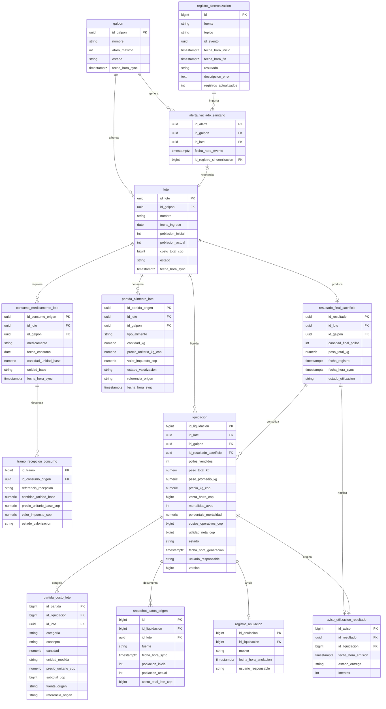

# General — Arquitectura y Stack Tecnológico

**Estado**: Referencia técnica transversal del Módulo 3  
**Fecha**: 23/10/2026  
**Diccionario de Dominio y Base de Datos**: [diccionario.md](../requisitos/diccionario.md)  

## Propósito

Este documento define la arquitectura, las tecnologías, el modelo de datos relacional (DER y DDL SQL), la infraestructura de integración (Apache Kafka y Apache POI) y las reglas técnicas comunes de AviControl Módulo 3 (Liquidación de Lote y Análisis de Rentabilidad). Es la fuente única de verdad para estas decisiones: los planes de implementación funcionales enlazan este archivo y documentan únicamente su alcance, modelos, contratos y tareas de implementación. Ningún plan repite el DDL.

---

## Stack Tecnológico

| Área | Tecnología adoptada | Uso en el proyecto |
| --- | --- | --- |
| Lenguaje | Java 21 (LTS) | Dominio, casos de uso, adaptadores y pruebas |
| Framework principal | Spring Boot 4.1.x (Spring Framework 7) | Configuración, ejecución y composición de la aplicación REST |
| Construcción | Gradle 9 (`build.gradle`, wrapper `gradlew`) | Gestión de dependencias, compilación y empaquetado |
| API HTTP | Spring Web MVC | Controladores REST síncronos |
| Validación | Jakarta Bean Validation | Validación de DTOs en adaptadores de entrada |
| Seguridad | — (sin autenticación) | La plataforma no tiene login. El usuario responsable se digita en el formulario (ver [Identidad del usuario](#identidad-del-usuario)) |
| Persistencia | Spring Data JPA + Hibernate | Repositorios y entidades JPA |
| Base de datos | PostgreSQL 16 en todos los perfiles | Copia local sincronizada y liquidaciones. No se usa H2: no soporta el índice único parcial `uq_lote_activa` |
| Migraciones | Flyway (`flyway-core`, `flyway-database-postgresql`) | Versionamiento y aplicación ordenada del esquema SQL |
| Mensajería inter-módulos | Apache Kafka + Spring Kafka 4 | **Único** mecanismo de integración con Módulo 1 y Módulo 2 (eventos entrantes) y aviso de utilización hacia Módulo 2 (evento saliente) |
| Exportación de reportes | Apache POI `poi-ooxml:5.2.5` | Generación de reportes Excel (CU05) |
| Serialización | Jackson 3 (paquete `tools.jackson`) | JSON para API REST y eventos Kafka |
| Documentación API | OpenAPI 3 (`springdoc-openapi` 3.x) | Descripción interactiva de endpoints en `/swagger-ui.html` |
| Pruebas unitarias | JUnit 5 y Mockito | Reglas de dominio y casos de uso aislados |
| Pruebas de integración | Spring Boot Test + Testcontainers 2 | PostgreSQL y Kafka reales durante las pruebas |
| Utilidades | Lombok | Reducción de código repetitivo (solo en `infrastructure`) |
| Calidad y arquitectura | Spotless y ArchUnit | Formato uniforme y verificación de límites entre capas |
| Observabilidad | Spring Boot Actuator y Micrometer | Salud (`/actuator/health`, incluye la conexión al broker) y métricas operativas |
| Entorno local | Docker Compose | PostgreSQL y Kafka para desarrollo local |
| Abstracción de tiempo | `java.time.Clock` | Fecha/hora inyectada para auditabilidad y pruebas deterministas |

### Comandos de construcción

| Acción | Comando (desde `backend/`) |
| --- | --- |
| Pruebas unitarias y de aceptación | `./gradlew test` |
| Pruebas de integración (Testcontainers) | `./gradlew integrationTest` |
| Todo (formato, pruebas, ArchUnit) | `./gradlew check` |
| Ejecutar en local | `./gradlew bootRun --args='--spring.profiles.active=dev'` |

---

## Arquitectura Limpia por Capas

El Módulo 3 se implementa con **Arquitectura Limpia por Capas**. Las dependencias siempre apuntan hacia adentro: la infraestructura depende de la aplicación, y la aplicación depende del dominio. El dominio no conoce nada de las capas externas.

```text
co.edu.unimagdalena.avicontrol/
├── AvicontrolApplication.java
│
├── domain/                            ← Núcleo. Cero dependencias externas.
│   ├── model/                         ← Entidades y enums puros: Liquidacion, Lote, Galpon, EtapaLote…
│   ├── exception/                     ← Excepciones de negocio: LoteNoLiquidableException, LiquidacionYaAnuladaException…
│   ├── port/
│   │   ├── in/                        ← Interfaces de casos de uso (Puertos de entrada)
│   │   │   ├── ListarLotesUseCase.java
│   │   │   ├── PreviewLiquidacionUseCase.java
│   │   │   ├── GenerarLiquidacionUseCase.java
│   │   │   ├── ConsultarLiquidacionUseCase.java
│   │   │   ├── AnularLiquidacionUseCase.java
│   │   │   ├── ConsultarHistorialUseCase.java
│   │   │   ├── ConsultarDesgloseUseCase.java
│   │   │   ├── ExportarExcelUseCase.java
│   │   │   ├── SincronizarModulo1UseCase.java
│   │   │   ├── SincronizarModulo2UseCase.java
│   │   │   └── dto/                   ← DTOs de casos de uso (records de Java puro) ★
│   │   │       ├── LoteResumenDto.java
│   │   │       ├── LotePageDto.java
│   │   │       ├── GenerarLiquidacionCommand.java
│   │   │       ├── LiquidacionPreviaDto.java
│   │   │       ├── LiquidacionDto.java
│   │   │       ├── AnulacionDto.java
│   │   │       ├── HistorialPageDto.java
│   │   │       ├── DesgloseDto.java
│   │   │       ├── EstadoSincronizacionDto.java
│   │   │       └── evento/            ← Datos de los eventos entrantes ya validados: GalponEvento, ResultadoSacrificioEvento…
│   │   └── out/                       ← Interfaces de repositorios y publicadores (Puertos de salida)
│   │       ├── GalponRepository.java
│   │       ├── LoteRepository.java
│   │       ├── AlertaVaciadoSanitarioRepository.java
│   │       ├── ResultadoSacrificioRepository.java
│   │       ├── PartidaAlimentoRepository.java
│   │       ├── ConsumoMedicamentoRepository.java
│   │       ├── LiquidacionRepository.java
│   │       ├── RegistroAnulacionRepository.java
│   │       ├── RegistroSincronizacionRepository.java
│   │       ├── AvisoUtilizacionRepository.java
│   │       ├── AvisoUtilizacionPublisher.java
│   │       └── GeneradorExcelPort.java
│   └── shared/                        ← Reglas transversales: Rounding.java, Pagina.java
│
├── application/                       ← Servicios de aplicación. Orquesta dominio.
│   └── service/
│       ├── ListarLotesService.java
│       ├── GenerarLiquidacionService.java
│       ├── ConsultarLiquidacionService.java
│       ├── AnularLiquidacionService.java
│       ├── ConsultarHistorialService.java
│       ├── ConsultarDesgloseService.java
│       ├── ExportarExcelService.java
│       └── sync/
│           ├── SyncModulo1Service.java
│           ├── SyncModulo2Service.java
│           ├── EstadoSincronizacionService.java
│           └── PublicarAvisosUtilizacionService.java
│
└── infrastructure/                    ← Adaptadores técnicos. Conoce Spring, JPA, Kafka y POI.
    ├── adapter/
    │   ├── rest/                      ← Controladores HTTP de entrada, Request/Response
    │   │   ├── LoteController.java
    │   │   ├── LiquidacionController.java
    │   │   ├── DesgloseController.java
    │   │   └── HistorialController.java
    │   ├── messaging/                 ← Kafka: consumidores de M1/M2 y productor del aviso
    │   │   ├── Modulo1EventConsumer.java
    │   │   ├── Modulo2EventConsumer.java
    │   │   └── AvisoUtilizacionKafkaProducer.java
    │   ├── persistence/               ← Entidades JPA (@Entity), repositorios Spring Data y mappers
    │   └── export/                    ← ExcelWorkbookBuilder (Apache POI), implementa GeneradorExcelPort
    ├── config/                        ← Configuración: Kafka, OpenAPI, Scheduler, Clock, Actuator
    └── exception/                     ← @RestControllerAdvice → ProblemDetail RFC 7807
```

> **★ Regla de Dependencias (Arquitectura Limpia Estricta)**: 
> 1. Los DTOs consumidos o retornados por los casos de uso se ubican en `co.edu.unimagdalena.avicontrol.domain.port.in.dto` como `record`s de Java puro. Los `*Request`/`*Response` HTTP y los sobres JSON de Kafka viven en `infrastructure` y se traducen a esos DTOs.
> 2. La capa `domain/` **NUNCA importa clases de `application/`, de `infrastructure/` ni de frameworks** (incluido `org.springframework.data.domain.Page`: la paginación del dominio usa `domain.shared.Pagina<T>`).
> 3. Los mappers que transforman entre entidades JPA y modelos o DTOs de dominio residen en `infrastructure`.
> 4. ArchUnit verifica estas reglas en `ArchitectureTest`.

### Capa `domain/`
Contiene el modelo de negocio puro: entidades (`Liquidacion`, `Galpon`, `Lote`, etc.), enums, value objects, excepciones de negocio, reglas de redondeo, interfaces de repositorios y publicadores (`port/out`), puertos de entrada de casos de uso (`port/in`) y sus DTOs (`port/in/dto`).
- **Regla estricta**: Java puro. No importa Spring, JPA, Jackson, Kafka ni clases de las capas externas.

### Capa `application/` (Servicios)
Contiene los servicios de aplicación que implementan las interfaces `port/in`, orquestan el dominio y procesan los eventos de sincronización ya traducidos por los consumidores. Define el límite transaccional (`@Transactional`) y no conoce controladores HTTP, entidades JPA, Kafka ni serialización.

### Capa `infrastructure/`
Contiene los adaptadores concretos:
- **`adapter/rest/`**: Controladores REST (entrada HTTP).
- **`adapter/messaging/`**: Consumidores Kafka de los eventos de Módulo 1 y Módulo 2, y productor del aviso de utilización.
- **`adapter/persistence/`**: Entidades JPA (`@Entity`), repositorios Spring Data y mappers hacia el dominio.
- **`adapter/export/`**: Construcción del libro Excel con Apache POI.
- **`config/`**: Configuración de Kafka, OpenAPI, Scheduler, `Clock` y Actuator.
- **`exception/`**: Manejador global de excepciones (`@RestControllerAdvice`) con RFC 7807 (`ProblemDetail`).

### Identidad del usuario

La plataforma **no tiene login** ni gestión de usuarios. No se usa Spring Security, JWT ni roles, y la API no responde `401` ni `403`. El "usuario responsable" que exigen M3-CU03 y M3-CU04 (RT-04) es un **texto que el Administrador Financiero digita** en el formulario de generación y en el de anulación, y viaja en el campo `usuario` del body (obligatorio, 3 a 100 caracteres, sin espacios al inicio ni al final).

---

## Modelo de Datos Relacional (DER y DDL SQL)

Convenciones:
- Fechas y horas en `TIMESTAMPTZ` (Java `Instant`). Los filtros por fecha del API se interpretan en la zona `America/Bogota`.
- Montos totales COP en `BIGINT`; precios unitarios en `NUMERIC(14,2)`.
- Los códigos de enum se almacenan en mayúsculas con guion bajo (`EN_COSECHA`, `ACTIVA`). La grafía que use Módulo 1 se traduce en el consumidor Kafka (D-07).

### A. Diagrama Entidad-Relación (DER en Mermaid)



> **Nota — Restricciones UNIQUE**: Mermaid `erDiagram` no admite múltiples calificadores en un atributo. Las siguientes restricciones existen en el DDL aunque no se representan con `UK` en el diagrama:
> - `alerta_vaciado_sanitario.id_lote` → `UNIQUE` — una sola alerta de vaciado sanitario por lote.
> - `resultado_final_sacrificio.id_lote` → `UNIQUE` — un solo resultado final por lote (CU08.FR-010).
> - `liquidacion.id_lote` → índice único parcial `uq_lote_activa` (`WHERE estado = 'ACTIVA'`) — máximo una Liquidación `ACTIVA` por lote; las `ANULADA` no cuentan, así que el lote admite una nueva Liquidación tras la anulación (CU03.FR-008, CU04.FR-007). Varias Liquidaciones (una activa y varias anuladas) pueden referenciar el mismo resultado de sacrificio.
> - `registro_anulacion.id_liquidacion` → `UNIQUE` — una sola anulación por Liquidación.
> - `aviso_utilizacion_resultado.id_resultado` → `UNIQUE` — un solo aviso por resultado; la Liquidación que lo origina es la primera que consumió el resultado (CU04, caso borde "Resultado ya avisado").
> - `registro_sincronizacion.id_evento` → `UNIQUE` — un evento Kafka se procesa una sola vez (idempotencia).

---

### B. Scripts SQL DDL Completos (Flyway Migrations)

Ubicación: `backend/src/main/resources/db/migration/`. Los datos de demostración van en `db/seed/` (solo perfil `dev`), ver [estructura del repositorio](../proceso/estructura-repositorio.md#6-backend-recursos-backendsrcmainresources).

#### `V1__create_sync_tables.sql`
```sql
CREATE TABLE registro_sincronizacion (
    id                     BIGSERIAL PRIMARY KEY,
    fuente                 VARCHAR(20)  NOT NULL,
    topico                 VARCHAR(100) NOT NULL,
    id_evento              UUID UNIQUE,
    fecha_hora_inicio      TIMESTAMPTZ  NOT NULL,
    fecha_hora_fin         TIMESTAMPTZ,
    resultado              VARCHAR(20),
    descripcion_error      TEXT,
    registros_actualizados INT NOT NULL DEFAULT 0,
    CONSTRAINT chk_sync_fuente    CHECK (fuente IN ('MODULO_1', 'MODULO_2')),
    CONSTRAINT chk_sync_resultado CHECK (resultado IN ('EXITOSA', 'FALLIDA'))
);

CREATE TABLE galpon (
    id_galpon       UUID PRIMARY KEY,
    nombre          VARCHAR(100) NOT NULL,
    aforo_maximo    INT          NOT NULL,
    estado          VARCHAR(30)  NOT NULL,
    fecha_hora_sync TIMESTAMPTZ  NOT NULL
);

CREATE TABLE lote (
    id_lote            UUID PRIMARY KEY,
    id_galpon          UUID         NOT NULL REFERENCES galpon(id_galpon),
    nombre             VARCHAR(100) NOT NULL,
    fecha_ingreso      DATE         NOT NULL,
    poblacion_inicial  INT          NOT NULL,
    poblacion_actual   INT          NOT NULL,
    costo_total_cop    BIGINT       NOT NULL,
    estado             VARCHAR(30)  NOT NULL,
    fecha_hora_sync    TIMESTAMPTZ  NOT NULL
);

CREATE TABLE alerta_vaciado_sanitario (
    id_alerta                  UUID PRIMARY KEY,
    id_galpon                  UUID        NOT NULL REFERENCES galpon(id_galpon),
    id_lote                    UUID        NOT NULL UNIQUE REFERENCES lote(id_lote),
    fecha_hora_evento          TIMESTAMPTZ NOT NULL,
    id_registro_sincronizacion BIGINT      NOT NULL REFERENCES registro_sincronizacion(id)
);

CREATE TABLE resultado_final_sacrificio (
    id_resultado          UUID PRIMARY KEY,
    id_lote               UUID          NOT NULL UNIQUE REFERENCES lote(id_lote),
    id_galpon             UUID          NOT NULL REFERENCES galpon(id_galpon),
    cantidad_final_pollos INT           NOT NULL,
    peso_total_kg         NUMERIC(12,2) NOT NULL,
    fecha_registro        TIMESTAMPTZ   NOT NULL,
    fecha_hora_sync       TIMESTAMPTZ   NOT NULL,
    estado_utilizacion    VARCHAR(20)   NOT NULL DEFAULT 'NO_UTILIZADO',
    CONSTRAINT chk_resultado_utilizacion CHECK (estado_utilizacion IN ('NO_UTILIZADO', 'UTILIZADO'))
);

CREATE TABLE aviso_utilizacion_resultado (
    id_aviso           BIGSERIAL PRIMARY KEY,
    id_resultado       UUID        NOT NULL UNIQUE REFERENCES resultado_final_sacrificio(id_resultado),
    id_liquidacion     BIGINT      NOT NULL,
    fecha_hora_emision TIMESTAMPTZ NOT NULL,
    estado_entrega     VARCHAR(20) NOT NULL DEFAULT 'PENDIENTE',
    intentos           INT         NOT NULL DEFAULT 0,
    CONSTRAINT chk_aviso_estado CHECK (estado_entrega IN ('PENDIENTE', 'ENTREGADO'))
);
```

#### `V2__create_partidas_tables.sql`
```sql
CREATE TABLE partida_alimento_lote (
    id_partida_origen      UUID PRIMARY KEY,
    id_lote                UUID          NOT NULL REFERENCES lote(id_lote),
    id_galpon              UUID          NOT NULL REFERENCES galpon(id_galpon),
    tipo_alimento          VARCHAR(50)   NOT NULL,
    cantidad_kg            NUMERIC(12,3) NOT NULL,
    precio_unitario_kg_cop NUMERIC(14,2),
    valor_impuesto_cop     NUMERIC(14,2),
    estado_valorizacion    VARCHAR(20)   NOT NULL DEFAULT 'VALORIZADA',
    referencia_origen      VARCHAR(200),
    fecha_hora_sync        TIMESTAMPTZ   NOT NULL,
    CONSTRAINT chk_alimento_valorizacion CHECK (estado_valorizacion IN ('VALORIZADA', 'PENDIENTE_PRECIO'))
);

CREATE TABLE consumo_medicamento_lote (
    id_consumo_origen    UUID PRIMARY KEY,
    id_lote              UUID          NOT NULL REFERENCES lote(id_lote),
    id_galpon            UUID          NOT NULL REFERENCES galpon(id_galpon),
    medicamento          VARCHAR(150)  NOT NULL,
    fecha_consumo        DATE          NOT NULL,
    cantidad_unidad_base NUMERIC(12,3) NOT NULL,
    unidad_base          VARCHAR(30)   NOT NULL,
    fecha_hora_sync      TIMESTAMPTZ   NOT NULL
);

CREATE TABLE tramo_recepcion_consumo (
    id_tramo                 BIGSERIAL PRIMARY KEY,
    id_consumo_origen        UUID          NOT NULL REFERENCES consumo_medicamento_lote(id_consumo_origen),
    referencia_recepcion     VARCHAR(200)  NOT NULL,
    cantidad_unidad_base     NUMERIC(12,3) NOT NULL,
    precio_unitario_base_cop NUMERIC(14,2),
    valor_impuesto_cop       NUMERIC(14,2),
    estado_valorizacion      VARCHAR(20)   NOT NULL DEFAULT 'VALORIZADA',
    CONSTRAINT uq_tramo_recepcion UNIQUE (id_consumo_origen, referencia_recepcion),
    CONSTRAINT chk_tramo_valorizacion CHECK (estado_valorizacion IN ('VALORIZADA', 'PENDIENTE_PRECIO'))
);
```

#### `V3__create_liquidacion_tables.sql`
```sql
CREATE TABLE liquidacion (
    id_liquidacion          BIGSERIAL PRIMARY KEY,
    id_lote                 UUID          NOT NULL REFERENCES lote(id_lote),
    id_galpon               UUID          NOT NULL REFERENCES galpon(id_galpon),
    id_resultado_sacrificio UUID          REFERENCES resultado_final_sacrificio(id_resultado), -- NULL solo en siniestro total
    pollos_vendidos         INT           NOT NULL,                                            -- 0 en siniestro total
    peso_total_kg           NUMERIC(12,2) NOT NULL,                                            -- 0.00 en siniestro total
    peso_promedio_kg        NUMERIC(8,4),                                                      -- NULL en siniestro total
    precio_kg_cop           NUMERIC(14,2),                                                     -- NULL en siniestro total
    venta_bruta_cop         BIGINT        NOT NULL,
    mortalidad_aves         INT           NOT NULL,
    porcentaje_mortalidad   NUMERIC(5,2)  NOT NULL,
    costos_operativos_cop   BIGINT        NOT NULL,
    utilidad_neta_cop       BIGINT        NOT NULL,
    estado                  VARCHAR(10)   NOT NULL DEFAULT 'ACTIVA',
    fecha_hora_generacion   TIMESTAMPTZ   NOT NULL,
    usuario_responsable     VARCHAR(100)  NOT NULL,
    version                 BIGINT        NOT NULL DEFAULT 0,                                  -- bloqueo optimista (@Version)
    CONSTRAINT chk_liquidacion_estado CHECK (estado IN ('ACTIVA', 'ANULADA'))
);

-- Máximo una Liquidación ACTIVA por lote; las ANULADA se conservan y no bloquean una nueva
CREATE UNIQUE INDEX uq_lote_activa ON liquidacion(id_lote) WHERE estado = 'ACTIVA';

CREATE TABLE partida_costo_lote (
    id_partida          BIGSERIAL PRIMARY KEY,
    id_liquidacion      BIGINT        NOT NULL REFERENCES liquidacion(id_liquidacion),
    id_lote             UUID          NOT NULL REFERENCES lote(id_lote),
    categoria           VARCHAR(20)   NOT NULL,
    concepto            VARCHAR(200)  NOT NULL,
    cantidad            NUMERIC(12,3) NOT NULL,
    unidad_medida       VARCHAR(30)   NOT NULL,
    precio_unitario_cop NUMERIC(14,2) NOT NULL,
    subtotal_cop        BIGINT        NOT NULL,
    fuente_origen       VARCHAR(20)   NOT NULL,
    referencia_origen   VARCHAR(200),
    CONSTRAINT chk_partida_categoria CHECK (categoria IN ('ALIMENTO', 'MEDICINA', 'POBLACION')),
    CONSTRAINT chk_partida_fuente    CHECK (fuente_origen IN ('MODULO_1', 'MODULO_2'))
);

CREATE TABLE snapshot_datos_origen (
    id                   BIGSERIAL PRIMARY KEY,
    id_liquidacion       BIGINT      NOT NULL REFERENCES liquidacion(id_liquidacion),
    id_lote              UUID        NOT NULL REFERENCES lote(id_lote),
    fuente               VARCHAR(20) NOT NULL,
    fecha_hora_sync      TIMESTAMPTZ NOT NULL,
    poblacion_inicial    INT,
    poblacion_actual     INT,
    costo_total_lote_cop BIGINT,
    CONSTRAINT uq_snapshot_fuente UNIQUE (id_liquidacion, fuente)
);

CREATE TABLE registro_anulacion (
    id_anulacion         BIGSERIAL PRIMARY KEY,
    id_liquidacion       BIGINT       NOT NULL UNIQUE REFERENCES liquidacion(id_liquidacion),
    motivo               VARCHAR(500) NOT NULL,
    fecha_hora_anulacion TIMESTAMPTZ  NOT NULL,
    usuario_responsable  VARCHAR(100) NOT NULL
);

-- FK diferida desde aviso_utilizacion_resultado (tabla creada en V1)
ALTER TABLE aviso_utilizacion_resultado
ADD CONSTRAINT fk_aviso_liquidacion FOREIGN KEY (id_liquidacion) REFERENCES liquidacion(id_liquidacion);

-- Índices de rendimiento para consultas y joins por lote y galpón
CREATE INDEX idx_lote_galpon ON lote(id_galpon);
CREATE INDEX idx_alerta_vaciado_galpon ON alerta_vaciado_sanitario(id_galpon);
CREATE INDEX idx_partida_alimento_lote ON partida_alimento_lote(id_lote);
CREATE INDEX idx_consumo_med_lote ON consumo_medicamento_lote(id_lote);
CREATE INDEX idx_partida_costo_liquidacion ON partida_costo_lote(id_liquidacion);
CREATE INDEX idx_snapshot_liquidacion ON snapshot_datos_origen(id_liquidacion);
CREATE INDEX idx_liquidacion_lote ON liquidacion(id_lote);
CREATE INDEX idx_liquidacion_fecha ON liquidacion(fecha_hora_generacion DESC);
CREATE INDEX idx_sync_fuente_fin ON registro_sincronizacion(fuente, fecha_hora_fin DESC);
CREATE INDEX idx_aviso_pendiente ON aviso_utilizacion_resultado(estado_entrega) WHERE estado_entrega = 'PENDIENTE';
```

### C. Reglas de llenado de `partida_costo_lote`

Las partidas se **congelan** al generar la Liquidación: se copian de la copia local y no cambian aunque M1 o M2 publiquen correcciones después.

| Categoría | Origen | `concepto` | `cantidad` / `unidad_medida` | `precio_unitario_cop` | `subtotal_cop` |
| --- | --- | --- | --- | --- | --- |
| `ALIMENTO` | `partida_alimento_lote` (una fila por partida) | `tipo_alimento` | `cantidad_kg` / `KG` | `precio_unitario_kg_cop` | `HALF_UP(cantidad × precio)` |
| `MEDICINA` | `tramo_recepcion_consumo` (una fila por tramo) | `medicamento` | `cantidad_unidad_base` / `unidad_base` tal como la informa M2 (`G`, `ML`, `UNIDAD`…) | `precio_unitario_base_cop` | `HALF_UP(cantidad × precio)` |
| `POBLACION` | `lote.costo_total_cop` (una sola fila) | `Costo de adquisición del lote (<poblacion_inicial> aves)` | `1` / `LOTE` | `costo_total_cop` | `costo_total_cop` |

`costos_operativos_cop` es la suma exacta de `subtotal_cop` (CU05.FR-002). El costo de población se registra como una sola partida por lote para que su subtotal coincida al peso con el valor de Módulo 1, sin el error de redondeo que produciría dividirlo por ave. El tratamiento del impuesto (`valor_impuesto_cop`) queda fuera del subtotal hasta que se resuelva D-05.

---

## Integración con Módulo 1 y Módulo 2 (Apache Kafka)

M3 se integra con los demás módulos **exclusivamente por eventos Kafka**. No hace llamadas REST a M1 ni a M2 y no consulta en vivo. Ver el modelo de integración normativo en la [especificación general](../requisitos/especificacion-general.md#modelo-de-integración-normativo).

### A. Tópicos

| Tópico | Productor | Consumidor | Clave | Evento | Caso de uso |
| --- | --- | --- | --- | --- | --- |
| `avicontrol.m1.galpones` | M1 | M3 | `idGalpon` | `GalponActualizadoEvent` (estado del galpón y su lote vinculado, completo) | CU07 |
| `avicontrol.m1.alertas-vaciado` | M1 | M3 | `idLote` | `AlertaVaciadoSanitarioEvent` | CU07 |
| `avicontrol.m2.resultados-sacrificio` | M2 | M3 | `idLote` | `ResultadoSacrificioPublicadoEvent` | CU08 |
| `avicontrol.m2.partidas-alimento` | M2 | M3 | `idLote` | `PartidaAlimentoPublicadaEvent` | CU09 |
| `avicontrol.m2.consumos-medicamento` | M2 | M3 | `idLote` | `ConsumoMedicamentoPublicadoEvent` (con sus tramos por recepción) | CU10 |
| `avicontrol.m3.avisos-utilizacion` | M3 | M2 | `idResultado` | `ResultadoUtilizadoEvent` | CU08 |
| `avicontrol.m3.dlt` | M3 | — | la original | Mensajes que fallaron tras los reintentos | Todos |

Los nombres de tópico y el formato de los eventos deben confirmarse con M1 y M2 (D-08). Mientras tanto, M3 desarrolla y prueba contra este contrato con Testcontainers y con los fixtures de `src/test/resources/fixtures/`.

### B. Reglas de consumo

- **Eventos con estado completo**: cada evento trae el estado completo de la entidad (no deltas), de modo que reprocesarlo produce el mismo resultado. Los tópicos de M1 y M2 se recomiendan compactados (`cleanup.policy=compact`) para que M3 pueda reconstruir su copia local desde el inicio.
- **Consumidor**: `groupId` `avicontrol-modulo3`, `auto-offset-reset=earliest`, confirmación manual del offset después de la transacción de base de datos.
- **Idempotencia**: cada evento lleva `eventId`. Si `registro_sincronizacion` ya tiene ese `id_evento` con resultado `EXITOSA`, el evento se descarta. Además, las escrituras son *upsert* por la llave natural (`id_galpon`, `id_lote`, `id_resultado`, `id_partida_origen`, `id_consumo_origen`); las alertas de vaciado se insertan solo si no existen (son inmutables).
- **Bitácora**: cada evento procesado crea una fila en `registro_sincronizacion` con `fuente`, `topico`, `id_evento`, inicio, fin, resultado y filas afectadas. La "última sincronización exitosa" de una fuente es el `MAX(fecha_hora_fin)` con `resultado = 'EXITOSA'` de esa fuente.
- **Datos inválidos** (CU07.FR-010, CU08.FR-003): el evento se registra como `FALLIDA` con la causa en `descripcion_error`, no sobrescribe la copia local y no se reintenta (es un error de contenido).
- **Errores técnicos** (base de datos caída, JSON ilegible): 3 reintentos con backoff exponencial (1 s, 2 s, 4 s) y luego el mensaje pasa a `avicontrol.m3.dlt`.
- **Indicador de antigüedad (RT-09)**: si una fuente no tiene eventos exitosos en las últimas `sync.umbral-inactividad` horas (por defecto 24) o el broker no está disponible (`/actuator/health`), la respuesta del API marca esa fuente como desactualizada para que la interfaz lo advierta.

### C. Sobre JSON de los eventos

Todos los eventos comparten el mismo sobre:

```json
{
  "header": {
    "eventId": "a1b2c3d4-e5f6-7890-abcd-ef1234567890",
    "eventType": "ResultadoSacrificioPublicadoEvent",
    "timestamp": "2026-10-02T15:30:00Z",
    "sourceModule": "MODULO_2"
  },
  "payload": { }
}
```

Los `payload` de cada tópico están en el [plan 001](../planes/001-sincronizacion-m1-m2.md#contratos-de-eventos-kafka).

### D. Aviso de utilización (patrón *outbox*)

1. Al persistir una Liquidación que consume un resultado de sacrificio, **en la misma transacción** se marca el resultado como `UTILIZADO` y, si ese resultado aún no tiene aviso, se inserta una fila `PENDIENTE` en `aviso_utilizacion_resultado`.
2. `PublicarAvisosUtilizacionService` (`@Scheduled(fixedDelayString = "${avisos.intervalo:PT1M}")`) publica los avisos `PENDIENTE` en `avicontrol.m3.avisos-utilizacion`. Si el broker confirma, el aviso pasa a `ENTREGADO`; si falla, sigue `PENDIENTE` y se incrementa `intentos`.
3. Un fallo del aviso nunca revierte ni bloquea la Liquidación (CU08.FR-007). Anular la Liquidación no retira el aviso.

### E. Exportación a Excel con Apache POI (`poi-ooxml:5.2.5`)
- **Construcción del Libro**: Uso de `XSSFWorkbook` con una hoja para la Matriz de Venta Final y el Desglose por Categorías (`ALIMENTO`, `MEDICINA`, `POBLACION`).
- **Formato Monetario COP**: `DataFormat` con la máscara `$#,##0` (sin decimales en totales).
- **Fórmulas Dinámicas**: Subtotales y total con `Cell.setCellFormula("SUM(...)")`, calculando el rango a partir del número real de partidas.
- **Salida HTTP**: `ByteArrayOutputStream` y respuesta binaria con `Content-Type: application/vnd.openxmlformats-officedocument.spreadsheetml.sheet`.

---

## Formato Estándar de Errores de API REST (RFC 7807 `ProblemDetail`)

Todos los endpoints de M3 responden con `application/problem+json` ante cualquier fallo. Todos los `type` usan la base `https://avicontrol.edu.co/errors/` e incluyen el campo extra `timestamp`. Algunos errores agregan campos extra propios (ver catálogo).

#### 1. HTTP 400 Bad Request (Error de Validación de Entrada)
```json
{
  "type": "https://avicontrol.edu.co/errors/validacion",
  "title": "Error de validación",
  "status": 400,
  "detail": "La solicitud contiene parámetros inválidos.",
  "instance": "/api/v1/liquidaciones",
  "timestamp": "2026-10-05T14:30:00-05:00",
  "errores": [
    { "campo": "precioKgCop", "mensaje": "El precio por kg debe ser un número positivo mayor que cero." },
    { "campo": "usuario", "mensaje": "El usuario responsable es obligatorio." }
  ]
}
```

#### 2. HTTP 404 Not Found (Recurso Inexistente)
```json
{
  "type": "https://avicontrol.edu.co/errors/liquidacion-no-encontrada",
  "title": "Recurso no encontrado",
  "status": 404,
  "detail": "No se encontró la liquidación con ID 99.",
  "instance": "/api/v1/liquidaciones/99",
  "timestamp": "2026-10-05T14:30:00-05:00"
}
```

#### 3. HTTP 409 Conflict (Conflicto de Regla de Negocio)
```json
{
  "type": "https://avicontrol.edu.co/errors/liquidacion-ya-existente",
  "title": "Conflicto de Liquidación",
  "status": 409,
  "detail": "El lote 98765432-e89b-12d3-a456-426614174000 ya cuenta con una liquidación en estado ACTIVA (ID: 1045). Anúlela antes de generar una nueva.",
  "instance": "/api/v1/liquidaciones",
  "timestamp": "2026-10-05T14:30:00-05:00",
  "idLiquidacionActiva": 1045
}
```

#### 4. HTTP 422 Unprocessable Entity (Lote no apto)
```json
{
  "type": "https://avicontrol.edu.co/errors/lote-no-liquidable",
  "title": "Lote no apto para liquidar",
  "status": 422,
  "detail": "Hay partidas de costo sin precio aplicable. No es posible liquidar.",
  "instance": "/api/v1/liquidaciones/previa",
  "timestamp": "2026-10-05T14:30:00-05:00",
  "causa": "PARTIDAS_SIN_PRECIO",
  "partidasPendientes": [
    { "categoria": "ALIMENTO", "concepto": "Engorde", "referenciaOrigen": "REC-2026-118" }
  ]
}
```

---

## Reglas Financieras y de Dominio

> **★ Regla Contable: Utilidad Neta vs. Mortalidad del Lote**:
> - La fórmula de Utilidad Neta es estrictamente:
>   $$\text{Utilidad Neta} = \text{Venta Bruta} - \text{Costos Operativos}$$
> - **Rol de la Mortalidad**: Los Costos Operativos (`costos_operativos_cop`) ya incluyen la adquisición inicial de la totalidad de las aves ingresadas más el alimento y vacunas que consumieron antes de morir. Por ende, la **Mortalidad del Lote** (`mortalidad_aves` y `porcentaje_mortalidad`) es un **indicador informativo y de desempeño técnico/biológico** que se reporta en la Matriz de Venta Final, y **no se resta monetariamente por segunda vez** de la Venta Bruta para evitar una doble deducción contable del costo de las aves muertas.

### Concurrencia

- **Generar**: si dos confirmaciones llegan a la vez para el mismo lote, el índice `uq_lote_activa` rechaza la segunda; el manejador global traduce la violación a `409 liquidacion-ya-existente`.
- **Anular**: `liquidacion.version` es el campo `@Version` de JPA. Si dos anulaciones llegan a la vez, la segunda falla por bloqueo optimista (o por el `UNIQUE` de `registro_anulacion`) y se responde `409 liquidacion-ya-anulada` (CU04, caso borde "Concurrencia").
- **Vista previa desactualizada**: la vista previa devuelve `huellaDatos`, un hash SHA-256 de los datos usados en el cálculo (identificadores y `fecha_hora_sync` de cada fuente, poblaciones, partidas y precio). La confirmación la reenvía; si la huella recalculada no coincide, se responde `409 vista-previa-desactualizada` y el frontend vuelve a pedir la vista previa y advierte el cambio (CU03, caso borde "Cambio de datos sincronizados durante la vista previa").

### Catálogo de errores del API

| Status | `type` (sufijo de `https://avicontrol.edu.co/errors/`) | Cuándo | Campos extra | Endpoints |
|---|---|---|---|---|
| `400` | `validacion` | Body o query param inválido: `precioKgCop <= 0` o ausente sin siniestro total, `precioKgCop` enviado en siniestro total, `usuario` vacío, `motivo` fuera de 10–500 caracteres, UUID mal formado, `etapa` fuera del catálogo, `page < 0`, `size` fuera de rango, `search` > 100 caracteres | `errores: [{campo, mensaje}]` | Todos |
| `400` | `rango-fechas-invalido` | `desde` posterior a `hasta` en el historial (CU06.FR-005) | — | `GET /liquidaciones` |
| `404` | `lote-no-encontrado` | El lote no existe en la copia local | — | `POST /liquidaciones`, `POST /liquidaciones/previa` |
| `404` | `liquidacion-no-encontrada` | No existe la Liquidación `{id}` | — | `GET /liquidaciones/{id}`, `/desglose`, `/desglose/excel`, `PUT .../anulacion` |
| `409` | `liquidacion-ya-existente` | El lote ya tiene una Liquidación `ACTIVA` | `idLiquidacionActiva` | `POST /liquidaciones`, `POST /liquidaciones/previa` |
| `409` | `vista-previa-desactualizada` | La huella de la confirmación no coincide con los datos actuales | — | `POST /liquidaciones` |
| `409` | `liquidacion-ya-anulada` | Se intenta anular una Liquidación `ANULADA` | `registroAnulacion: {idAnulacion, motivo, fechaHoraAnulacion, usuarioResponsable}` | `PUT .../anulacion` |
| `409` | `exportacion-no-permitida` | Se pide el Excel de una Liquidación `ANULADA` (CU05.FR-004) | — | `GET .../desglose/excel` |
| `422` | `lote-no-liquidable` | El lote no cumple las precondiciones de CU03 | `causa` (ver abajo); `partidasPendientes` solo con `PARTIDAS_SIN_PRECIO` | `POST /liquidaciones`, `POST /liquidaciones/previa` |
| `500` | `error-interno` | Error no controlado (p. ej. falla al generar el Excel); el `detail` no expone trazas | — | Todos |

Valores de `causa` en `422 lote-no-liquidable` (en orden de evaluación):

| `causa` | Condición | Spec |
|---|---|---|
| `SIN_ALERTA_VACIADO` | El lote no tiene alerta de vaciado sanitario (etapa distinta de `POR_LIQUIDAR`) | CU03.FR-005, esc. 7 |
| `SIN_RESULTADO_SACRIFICIO` | No hay resultado de sacrificio válido y la población actual es mayor que 0 | CU03.FR-005, esc. 2 |
| `SIN_PARTIDAS_ALIMENTO` | No hay ninguna partida de alimento sincronizada (la ausencia de medicamentos es válida, CU10.FR-007) | CU03 esc. 5 |
| `PARTIDAS_SIN_PRECIO` | Alguna partida de alimento o tramo de medicamento está `PENDIENTE_PRECIO` | CU03.FR-006, esc. 4 |

### Catálogo de endpoints REST de M3

| Método y ruta | Query params | Respuesta OK | Plan |
|---|---|---|---|
| `GET /api/v1/lotes` | `etapa`, `search`, `page`, `size` | `200` `LotePageDto` | 002 |
| `POST /api/v1/liquidaciones/previa` | — | `200` `LiquidacionPreviaDto` (no persiste) | 003 |
| `POST /api/v1/liquidaciones` | — | `201` `LiquidacionDto` + `Location` | 003 |
| `GET /api/v1/liquidaciones/{id}` | — | `200` `LiquidacionDto` | 003 |
| `PUT /api/v1/liquidaciones/{id}/anulacion` | — | `200` `AnulacionDto` | 003 |
| `GET /api/v1/liquidaciones` | `search`, `desde`, `hasta`, `page`, `size` | `200` `HistorialPageDto` | 004 |
| `GET /api/v1/liquidaciones/{id}/desglose` | — | `200` `DesgloseDto` | 004 |
| `GET /api/v1/liquidaciones/{id}/desglose/excel` | — | `200` archivo `.xlsx` | 004 |
| `GET /api/v1/sincronizacion/estado` | — | `200` `EstadoSincronizacionDto` (última sincronización exitosa y si está desactualizada, por fuente; RT-09) | 001 |

---

## Ciclo de Vida de la Liquidación (Máquina de Estados)

La Liquidación solo tiene dos estados: `ACTIVA` y `ANULADA`. La vista previa no es un estado: no se persiste (CU03.FR-015).

```text
   [ POST /api/v1/liquidaciones (validaciones + huella OK) ]
                         │
                         ▼
                    ┌─────────┐
                    │ ACTIVA  │ ◄── (Estado oficial e inmutable)
                    └────┬────┘
                         │
                         │ PUT /api/v1/liquidaciones/{id}/anulacion
                         ▼
                    ┌─────────┐
                    │ ANULADA │ ◄── (Estado terminal auditable;
                    └─────────┘      libera el lote para re-liquidar)
```

---

## Desarrollo y Pruebas sin Módulo 1 ni Módulo 2

- **Perfil `dev`**: Docker Compose levanta PostgreSQL y Kafka. Flyway aplica `db/migration` y además `db/seed` con galpones, lotes, alertas, resultados y partidas de demostración, de modo que la API funciona sin que M1 ni M2 publiquen nada.
- **Pruebas de integración**: Testcontainers levanta PostgreSQL y Kafka; las pruebas publican los eventos de `src/test/resources/fixtures/m1/` y `fixtures/m2/` en los tópicos y verifican la copia local resultante.
- **Pruebas unitarias**: los puertos `port/out` se simulan con Mockito; no se necesita broker ni base de datos.
